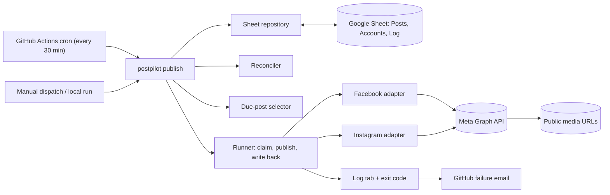
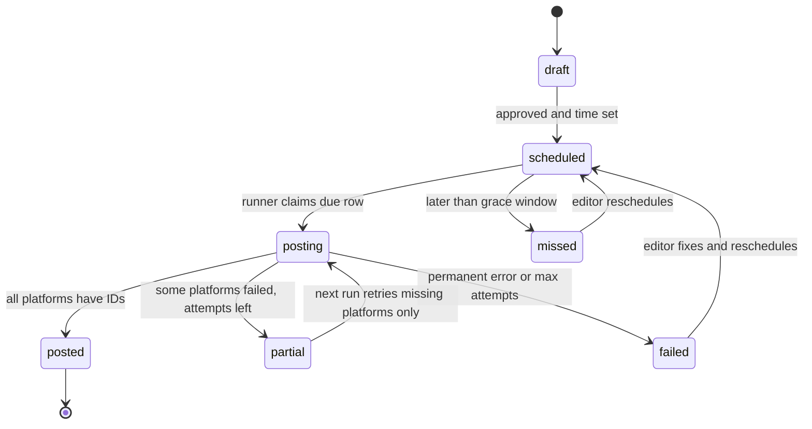
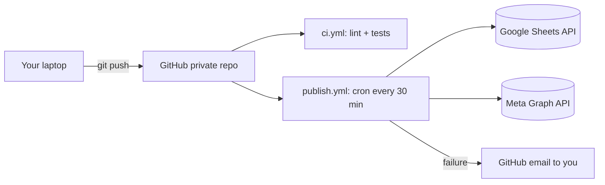

# PostPilot — Project Blueprint

**Project 4 of 4 · Social media scheduler / reposter**
Version 1.0 · October 2026 · Status: ready to build

> Plan a month of Facebook and Instagram posts in a Google Sheet. PostPilot publishes them on time, writes back the links, never double-posts, and can turn RSS/YouTube feeds into scheduled posts automatically.

---

## How to use this blueprint with Claude Code

1. Build this **after TindaBot**: you'll reuse the same Meta developer app knowledge.
2. Save this file as `docs/BLUEPRINT.md`; copy the CLAUDE.md starter from **section 20**.
3. Build one phase at a time from **section 18**, e.g.:
   `Read docs/BLUEPRINT.md sections 9, 10.3 and 18. Implement tasks 6.1–6.3 only. Run the tests, then stop and summarize.`
4. `/clear` between phases. Always use `--dry-run` until Phase 6 tests pass.

---

## 1. Product definition

| | |
|---|---|
| **What it is** | A Python CLI that reads a content calendar from Google Sheets and publishes due posts to Facebook Pages and Instagram professional accounts via the Meta Graph API, run on a schedule by GitHub Actions. |
| **Problem** | Social media managers juggle many posts and clients. Built-in schedulers work one account at a time, don't support sheet-based bulk planning or approvals, and don't produce a simple log for client reporting. |
| **Value** | Plan in a familiar Sheet, bulk-schedule across accounts, see status and permalinks in one place, auto-draft posts from feeds, zero hosting cost. |
| **Platform** | CLI + GitHub Actions (scheduler) + Google Sheets (UI). No server, no database. |
| **Expected scale** | 1–10 accounts, up to ~20 posts/day total. |
| **Authentication** | None in-app. Access is controlled by Sheet sharing (editors) and GitHub (operator). |
| **Real-time / offline** | No (publishes within the run interval) / No. |
| **Notifications** | Yes: GitHub emails the operator when a run fails; optional summary email (V1). |
| **Payments / admin panel** | No / No (the Sheet is the admin panel). |

### Assumptions
- Target platforms: Facebook Pages and Instagram professional (Business/Creator) accounts. Other platforms have paid tiers, audits, or partner requirements; add only if a client pays for it.
- Timing precision of ±30 minutes is acceptable (GitHub cron). Exact-time needs are covered in V1 by Facebook's native scheduling.
- Media is already hosted at public HTTPS URLs (V1 adds an uploader).
- You manage accounts where you have a legitimate role (your own demo accounts or clients who added you).

### Why not just use Meta Business Suite's free scheduler?
It's great for one account at a time. PostPilot adds: Sheet-based bulk planning, an approval column, many clients in one place, feed-to-post automation, a posting log with permalinks, and weekly insights in the Sheet (V1). Be upfront with clients about this.

---

## 2. Goals and non-goals

**Primary goals**
- Publish FB text/link/photo posts and IG single-image posts from Sheet rows at the scheduled time (±30 min).
- Write back status, post IDs, permalinks, and errors to the Sheet.
- Never double-post, even after crashes or retries.
- Validate rows before publishing, with clear error messages.
- Run for free on GitHub Actions.

**Secondary goals**
- Video/Reels/carousels, media uploads, RSS/YouTube → drafts, approvals, multi-account, first comment, insights.

**Non-goals**
- Engagement automation (auto-liking, auto-following, auto-DMs). This violates platform rules and risks account bans.
- A custom web app or calendar UI in MVP.
- Personal Facebook profiles (the API doesn't support posting to them).
- Scraping other people's content for reposting without permission.

---

## 3. Users, roles, and permissions

| Persona | Who | Goal |
|---|---|---|
| **Social media manager "Bea"** | Freelancer handling 3–8 small business clients | Plan a month in one sitting; proof for clients |
| **Business owner "Tito Ben"** | Café owner who approves posts | See and approve before anything goes live |
| **VA content writer** | Writes captions in the Sheet | Simple columns, clear errors |
| **Operator (you)** | Sets up tokens, GitHub, Sheet | Reliable, cheap, low-maintenance |

| Capability | Editor (writer) | Approver (client) | Operator |
|---|---|---|---|
| Add/edit draft rows | ✅ | ✅ | ✅ |
| Set `approved = TRUE` | ❌ (protected column, V1) | ✅ | ✅ |
| Edit status/ID columns | ❌ (protected, warning) | ❌ | ✅ |
| Change tokens, schedule, code | ❌ | ❌ | ✅ |

In MVP, column protection is "warning only" (set by `init-sheet`). V1 uses real protected ranges so only approvers can edit `approved`.

---

## 4. Features

### MVP (P0)
| ID | Feature | Summary |
|---|---|---|
| F1 | Sheet schema + init | `init-sheet` creates tabs, headers, dropdowns, conditional formatting, protected columns |
| F2 | Row validation | `validate` checks every row and writes errors to the row |
| F3 | Due-post selection | Approved + scheduled + due, within a lateness grace window |
| F4 | Facebook publishing | Text, link, single photo |
| F5 | Instagram publishing | Single image (container → publish) |
| F6 | Claim + write-back | `posting` claim before publishing; IDs/permalinks/errors after |
| F7 | Idempotency + reconciliation | Per-platform IDs prevent reposts; stale claims reconciled |
| F8 | Retries + error classes | Transient vs permanent vs auth errors |
| F9 | Dry run | Full run without calling publish endpoints |
| F10 | GitHub Actions | Scheduled + manual workflows; CI tests |
| F11 | `doctor` | Checks token validity, permissions, IG publishing quota, Sheet access |

### V1 (P1)
| ID | Feature | Summary |
|---|---|---|
| F12 | Video, Reels, carousels | FB video, IG Reels (with status polling), IG carousels |
| F13 | Media uploader | `postpilot upload <file>` → public URL (Supabase Storage or Cloudinary) |
| F14 | Feed reposter | RSS/YouTube feeds → new rows (draft or auto-approved) with caption templates |
| F15 | Multi-account | Accounts tab; one token secret per account |
| F16 | First comment | Post hashtags as the first IG comment |
| F17 | Exact-time FB | Use Facebook's native scheduled publishing for FB-only rows |
| F18 | Insights | 24 h and 7-day metrics pulled into an Insights tab |
| F19 | Run summary email | Daily digest of posted/failed |

### V2 (P2–P3)
| ID | Feature | Summary |
|---|---|---|
| F20 | Evergreen recycling | Re-queue top posts every N weeks |
| F21 | AI caption variants | Claude API suggests caption versions (paid) |
| F22 | More platforms | LinkedIn, etc., as clients require |
| F23 | Web calendar view | Read-only calendar page from the Sheet |

---

## 5. Core workflows

### W1 — Plan and approve
1. Editor adds rows: account, platforms, publish time (Manila time), caption, media URL.
2. Operator (or scheduled job) runs `postpilot validate` → invalid rows get `last_error` filled and stay unpublished.
3. Approver sets `approved = TRUE` and `status = scheduled`.

### W2 — Scheduled publish run (every 30 minutes)
1. GitHub Actions starts `postpilot publish`.
2. Read Posts + Accounts tabs in one batch.
3. **Reconcile** rows stuck in `posting` for > 30 min (section 10.5).
4. **Select** due rows: `approved = TRUE`, `status = scheduled` (or `partial` with attempts left), `publish_at ≤ now`. Rows later than the grace window → `missed` (never post stale content silently).
5. **Claim** up to `PP_MAX_POSTS_PER_RUN` rows: write `status=posting`, `run_id`, `attempts+1` in one batch update.
6. For each row, for each platform **without an ID yet**: publish → immediately write that platform's ID + permalink back.
7. Set final status: `posted` (all platforms done), `partial` (some failed, attempts left), `failed` (permanent error or max attempts).
8. Append results to the Log tab. Exit code 1 if any row failed → GitHub emails the operator.

### W3 — Fix a failed post
Editor reads `last_error` (e.g., "Instagram needs an image or video"), fixes the row, sets `status = scheduled` and a new `publish_at`. Already-published platforms are skipped because their IDs are filled.

### W4 — Feed reposter (V1)
`postpilot feeds-sync` (scheduled daily) reads the Feeds tab → fetches each RSS/YouTube feed → new items (by GUID, tracked in FeedItems tab) become Posts rows using the feed's caption template (`{title}\n\n{link}`), placed in the next free time slot, as `draft` or `scheduled` depending on `auto_approve`.

---

## 6. Tech stack

| Area | Choice | Why | Alternatives considered |
|---|---|---|---|
| Language | Python 3.12 | Same stack as your other projects | Node.js |
| Project + deps | uv | Fast CI installs, lockfile | pip |
| CLI | Typer + Rich | Typed commands | argparse |
| HTTP | httpx | Timeouts, clean API | requests |
| Graph API | Thin custom client over httpx | Few endpoints; avoids unmaintained SDKs | facebook-sdk (stale) |
| Sheets | gspread + service account | Simple, free | Google API client |
| Models / config | pydantic v2, pydantic-settings | Row validation, env validation | — |
| Time zones | `zoneinfo` (stdlib) | Asia/Manila handling | pytz |
| Retries | tenacity | Backoff for transient errors | — |
| Feeds (V1) | feedparser | Robust RSS/Atom parsing | Custom XML parsing |
| Media storage (V1) | Supabase Storage (public bucket) or Cloudinary free tier | Public URLs Meta can fetch | Google Drive (unreliable direct links) |
| Scheduler | GitHub Actions cron | Free, no server | cron on a VPS, Render cron (paid) |
| State storage | The Google Sheet itself | No database to host; visible to users | SQLite/Postgres (unneeded here) |
| Tests | pytest, respx, time-machine | Mock Graph API; freeze time | freezegun |
| Quality | ruff | One tool | — |

**Trade-off of Sheet-as-database:** Sheets API quotas (about 60 requests/minute per user) and no transactions. Fine at this scale if every run uses batch reads/writes and the claim + per-platform-ID design in section 10.

**Instagram login options:** Meta offers Instagram API with Facebook Login (IG account linked to a Page) and Instagram API with Instagram Login (no Page needed). MVP uses the Facebook Login path so one token covers both FB and IG; confirm current requirements in Meta's docs.

---

## 7. Architecture

**Style:** a small modular monolith run as a batch job. Platform adapters share one interface.



**Key interface:**
```python
class PlatformAdapter(Protocol):
    name: Literal["facebook", "instagram"]
    def validate(self, post: Post) -> list[str]: ...                   # human-readable problems
    def publish(self, post: Post, account: Account) -> PublishResult: ...
    def find_recent(self, account: Account, since: datetime) -> list[RemotePost]: ...  # for reconciliation
```
The runner knows nothing about Graph API details; adapters know nothing about Sheets.

---

## 8. Repository structure

```
postpilot/
├── src/postpilot/
│   ├── __init__.py
│   ├── cli.py                   # init-sheet, validate, publish, doctor, (V1) upload, feeds-sync, insights
│   ├── config.py
│   ├── logging_setup.py
│   ├── models.py                # Post, Account, PublishResult, RemotePost, RunReport
│   ├── timeutil.py              # parse publish_at in account tz; now(); grace window
│   ├── sheet/
│   │   ├── client.py            # gspread auth from env JSON
│   │   ├── schema.py            # column names, enums, header order
│   │   ├── init_sheet.py        # tabs, dropdowns, formatting, protection
│   │   └── repository.py        # batch read/write, claim, write-back, log append
│   ├── scheduler/
│   │   ├── selector.py          # due, missed, retryable
│   │   ├── reconcile.py         # stale "posting" rows
│   │   └── runner.py            # orchestration per run
│   ├── platforms/
│   │   ├── base.py
│   │   ├── graph_client.py      # httpx wrapper, version pinning, error parsing
│   │   ├── errors.py            # error classification
│   │   ├── facebook.py
│   │   └── instagram.py
│   ├── media/
│   │   └── uploader.py          # V1
│   ├── feeds/
│   │   └── rss.py               # V1
│   ├── insights.py              # V1
│   └── notify.py                # V1 summary email
├── .github/workflows/
│   ├── ci.yml                   # lint + tests on push/PR
│   └── publish.yml              # scheduled + manual publish
├── tests/
│   ├── fixtures/graph/          # sample Graph API responses incl. errors
│   ├── fakes/                   # in-memory sheet repository, fake adapters
│   ├── unit/
│   └── integration/
├── docs/
│   └── BLUEPRINT.md
├── .env.example
├── pyproject.toml
├── uv.lock
├── README.md
└── CLAUDE.md
```

---

## 9. Data model (Google Sheet)

### Posts tab
| Column | Example | Rules |
|---|---|---|
| `id` | `P-0042` | Auto-filled by `validate` if blank; unique |
| `account` | `kape_demo` | Must exist in Accounts tab |
| `platforms` | `facebook,instagram` | Dropdown/comma list |
| `publish_at` | `2026-10-05 18:00` | Local time in the account's time zone |
| `caption` | `New ube latte! ☕…` | IG ≤ 2,200 chars, ≤ 30 hashtags |
| `media_type` | `image` | `none` / `image` (MVP); `video` / `reel` / `carousel` (V1) |
| `media_urls` | `https://…/latte.jpg` | HTTPS; newline-separated for carousels |
| `link` | `https://kapedemo.ph/menu` | Facebook only |
| `first_comment` | `#ubelatte #manilacafe` | V1 |
| `approved` | `TRUE` | Checkbox |
| `status` | `scheduled` | `draft` / `scheduled` / `posting` / `posted` / `partial` / `failed` / `missed` / `skipped` |
| `run_id` | `2026-10-05T10:07Z-a1b2` | Written by claim |
| `attempts` | `1` | Written by claim |
| `fb_post_id`, `ig_media_id` | `1234_5678` | Written on success; **presence means "don't post again"** |
| `fb_permalink`, `ig_permalink` | URLs | Written on success |
| `last_error` | `Instagram needs an image` | Human-readable |
| `posted_at` | ISO time | |

### Accounts tab
| Column | Example | Notes |
|---|---|---|
| `account` | `kape_demo` | Key used in Posts |
| `fb_page_id` | `1029384756` | |
| `ig_user_id` | `1784…` | IG professional account ID |
| `token_env` | `META_TOKEN_KAPE_DEMO` | **Name** of the env var/GitHub secret holding the token (never the token itself) |
| `timezone` | `Asia/Manila` | IANA name |
| `active` | `TRUE` | |

### Log tab
`timestamp, run_id, post_id, platform, result (ok/error/skipped/dry_run), message, remote_id`. Trimmed to the last 5,000 rows.

### V1 tabs
- **Feeds:** `feed_id, url, account, platforms, caption_template, media_from (feed_image/none), auto_approve, slot_times (e.g. 09:00,18:00), active`
- **FeedItems:** `feed_id, guid, post_id, created_at` (dedupe)
- **Insights:** `post_id, platform, collected_at, window (24h/7d), metric, value`

### Post status lifecycle


---

## 10. Core logic specifications

### 10.1 Validation rules (`validate`)
- `account` exists and is active; its token env var is present at publish time.
- `publish_at` parses in the account's time zone (formats: `YYYY-MM-DD HH:MM`, `YYYY-MM-DD HH:MM:SS`).
- Instagram rows must have media (IG has no text-only posts). JPEG is the safe image format; check Meta's docs for current size and aspect-ratio limits (historically ≤ 8 MB, 4:5 to 1.91:1).
- Caption ≤ 2,200 chars and ≤ 30 hashtags for Instagram.
- `media_urls` are HTTPS; at publish time a HEAD request confirms 200 + image/video content type.
- `link` only used for Facebook; warn if set for IG-only rows.
- Validation errors are **permanent** → `last_error`, row not published.

### 10.2 Selection and timing
- `now` is UTC; `publish_at` converted from the account time zone (Asia/Manila is UTC+8, no daylight saving).
- Due: `publish_at ≤ now` and `now − publish_at ≤ PP_LATE_GRACE_MINUTES` (default 180).
- Older than grace → `missed`.
- Order by `publish_at`, then row order; cap at `PP_MAX_POSTS_PER_RUN` (default 10).

### 10.3 Claim and idempotency (the most important logic)
1. **Claim:** one batch update sets `status=posting`, `run_id`, `attempts+1` for selected rows. Only one run executes at a time thanks to the GitHub `concurrency` group.
2. **Per-platform skip:** if `fb_post_id` is filled, never call Facebook publish for that row again; same for `ig_media_id`.
3. **Immediate write-back:** after each successful publish, write that platform's ID and permalink **before** publishing the next platform. This shrinks the crash window to a single API call.
4. **Final status** written at the end of each row.

### 10.4 Graph API calls
| Action | Call | Key params |
|---|---|---|
| FB text / link post | `POST /{page-id}/feed` | `message`, `link` |
| FB photo post | `POST /{page-id}/photos` | `url`, `caption` |
| FB video (V1) | `POST /{page-id}/videos` | `file_url`, `description` |
| FB exact-time (V1) | `POST /{page-id}/feed` | `published=false`, `scheduled_publish_time` |
| FB permalink | `GET /{post-id}?fields=permalink_url` | |
| IG image container | `POST /{ig-user-id}/media` | `image_url`, `caption` |
| IG Reel container (V1) | `POST /{ig-user-id}/media` | `media_type=REELS`, `video_url`, `caption` |
| IG carousel (V1) | Child containers with `is_carousel_item=true`, then `media_type=CAROUSEL`, `children` | |
| IG container status | `GET /{container-id}?fields=status_code` | Poll every 5 s until `FINISHED` (max 5 min) |
| IG publish | `POST /{ig-user-id}/media_publish` | `creation_id` |
| IG permalink | `GET /{media-id}?fields=permalink` | |
| IG first comment (V1) | `POST /{media-id}/comments` | `message` |
| IG publishing quota | `GET /{ig-user-id}/content_publishing_limit` | Used by `doctor` and before publishing |

All calls use `META_GRAPH_VERSION` (pinned) and the account's token. Permissions typically needed: `pages_show_list`, `pages_read_engagement`, `pages_manage_posts`, `instagram_basic`, `instagram_content_publish` (plus `instagram_manage_comments` and insights permissions in V1). Confirm current names and access levels in Meta's docs.

### 10.5 Reconciliation of stale `posting` rows
For rows in `posting` longer than `PP_STALE_POSTING_MINUTES` (30) with a missing platform ID:
1. Fetch recent posts from that platform (`/{page-id}/posts?fields=message,created_time,permalink_url` or `/{ig-user-id}/media?fields=caption,timestamp,permalink`) since `publish_at − 10 min`.
2. If one matches the caption (normalized, first 100 chars), record its ID/permalink → no repost.
3. Otherwise return the row to `partial` so the next run retries that platform.

### 10.6 Error classification
| Class | Examples | Action |
|---|---|---|
| **Auth** | Graph error code 190 (invalid/expired token), permission errors (10, 200–299) | Stop that account for this run; row → `failed` with "Token/permission problem, operator notified"; exit code 1 |
| **Rate limit** | Codes 4, 17, 32, 613; IG publishing quota reached | Leave row `scheduled`/`partial`; retry next run |
| **Transient** | HTTP 5xx, timeouts, code 1/2 | Retry 3× in-run with backoff; then `partial` |
| **Permanent** | Code 100 (invalid parameter), media fetch failure, IG container `ERROR` | `failed` with a readable message |
| **Policy** | Code 368 (temporarily blocked) | `failed`; operator notified; pause that account |

Error messages written to the Sheet are translated to plain language (e.g., "Instagram couldn't download the image. Check the link opens in a private browser window.").

### 10.7 GitHub Actions workflow (`publish.yml`)
```yaml
name: publish
on:
  schedule:
    - cron: "7,37 * * * *"          # every 30 min, off the busy top of the hour (UTC)
  workflow_dispatch:
    inputs:
      dry_run:
        type: boolean
        default: false
concurrency:
  group: postpilot-publish
  cancel-in-progress: false
jobs:
  publish:
    runs-on: ubuntu-latest
    timeout-minutes: 10
    steps:
      - uses: actions/checkout@v4          # update to the latest major versions
      - uses: astral-sh/setup-uv@v5
      - run: uv sync --frozen
      - run: uv run postpilot publish ${{ inputs.dry_run && '--dry-run' || '' }}
        env:
          GOOGLE_SERVICE_ACCOUNT_JSON: ${{ secrets.GOOGLE_SERVICE_ACCOUNT_JSON }}
          GOOGLE_SHEET_ID: ${{ secrets.GOOGLE_SHEET_ID }}
          META_GRAPH_VERSION: ${{ vars.META_GRAPH_VERSION }}
          META_TOKEN_KAPE_DEMO: ${{ secrets.META_TOKEN_KAPE_DEMO }}
```
**Notes:**
- Scheduled runs can start several minutes late when GitHub is busy.
- Use a **private repo**. The Free plan includes a monthly allowance of Actions minutes for private repos (2,000 at time of writing) and each run rounds up to at least a minute; every 30 min ≈ 1,440 runs/month, which fits. Every 15 min would not.
- In public repos, scheduled workflows are disabled after 60 days without repo activity, and logs are public. Another reason for private.

### 10.8 Feed reposter (V1)
- Fetch with feedparser; items keyed by `guid` (or link) and deduped via FeedItems.
- Caption template variables: `{title}`, `{link}`, `{summary}` (plain text, truncated to 300 chars).
- Media: feed image if `media_from=feed_image` (e.g., YouTube thumbnail), else FB link post only.
- Slot assignment: next free `slot_times` entry for that account, never two posts in the same slot.
- Only use feeds the client owns or has permission to share.

---

## 11. Configuration (`.env.example`)

```bash
# --- Google Sheets ---
GOOGLE_SERVICE_ACCOUNT_JSON=        # full JSON (locally you may use GOOGLE_SERVICE_ACCOUNT_FILE instead)
GOOGLE_SERVICE_ACCOUNT_FILE=secrets/service_account.json
GOOGLE_SHEET_ID=

# --- Meta ---
META_GRAPH_VERSION=                 # pin the current version from your app dashboard, e.g. vXX.0
META_TOKEN_KAPE_DEMO=               # one variable per account; name referenced in Accounts.token_env

# --- Behavior ---
PP_DEFAULT_TIMEZONE=Asia/Manila
PP_LATE_GRACE_MINUTES=180
PP_MAX_POSTS_PER_RUN=10
PP_MAX_ATTEMPTS=3
PP_STALE_POSTING_MINUTES=30
PP_DRY_RUN=false
PP_LOG_TAB_MAX_ROWS=5000

# --- V1 ---
SUPABASE_URL=
SUPABASE_SERVICE_KEY=
SUPABASE_BUCKET=postpilot-media
SUMMARY_EMAIL_TO=
SMTP_USER=
SMTP_APP_PASSWORD=
```
**Environments:** local development uses a separate "PostPilot TEST" Sheet and a demo Page/IG account with `--dry-run` by default; production uses the client Sheet and GitHub Secrets.

---

## 12. Error handling and logging

- Every run produces a `RunReport`: selected, posted, partial, failed, missed, skipped, duration.
- Console output (visible in GitHub Actions logs): counts and row IDs only. **Never** print tokens or the service-account JSON (GitHub masks registered secrets, but don't rely on it).
- Sheet Log tab: one line per platform attempt.
- Exit codes: `0` all good · `1` at least one failure (triggers GitHub email) · `2` configuration error (missing secret, Sheet unreachable).
- `doctor` output example: token valid ✔, expires: never ✔, permissions ✔, IG publishing quota 3/100 used ✔, Sheet reachable ✔, Accounts tab valid ✔.

---

## 13. Security and compliance

- **Tokens:** stored only in GitHub Secrets (prod) and `.env` (local, gitignored). The Accounts tab stores the *name* of the secret, never the token.
- **Long-lived tokens:** exchange a user token for a long-lived one, then fetch Page tokens (which don't expire when derived from a long-lived user token), or better for agencies, use a **System User** token from Meta Business settings. `doctor` warns before any expiry.
- **Least privilege:** request only the permissions in section 10.4. The service account is shared only on this Sheet.
- **Media URLs:** HTTPS only; HEAD-checked; never fetch internal/private addresses.
- **Platform rules:** no engagement automation, reasonable posting volume, respect IG's publishing quota. Only post content the client owns or has rights to.
- **Private repo** and GitHub 2FA on your account.
- **Dependencies:** pinned in `uv.lock`; Dependabot or monthly manual update.

---

## 14. Testing strategy

| Layer | What | Tools |
|---|---|---|
| Unit | validation rules, time parsing/grace window, selector, error classifier, caption/hashtag checks | pytest, time-machine |
| Adapter | Facebook/Instagram adapters against fixture responses (success, 190, 4, 100, container ERROR) | pytest, respx |
| Runner | Fake sheet repository + fake adapters: claim, write-back order, final statuses | pytest |
| Idempotency | Crash after FB success, before IG → rerun → FB not called again, IG called once | pytest |
| Reconciliation | Stale `posting` with a matching remote post → ID recorded, no publish call | pytest |
| Live (manual) | Demo Page + IG account, 3 rows, real publish | Checklist |

CI (`ci.yml`): `ruff check`, `ruff format --check`, `pytest` on every push/PR.

---

## 15. Setup, running, and deployment

### Meta setup
1. Create a demo Facebook Page and an Instagram **professional** account; link the IG account to the Page.
2. In your Meta developer app (the one from TindaBot, or a new Business-type app), add the needed products/permissions.
3. Use Graph API Explorer to get a user token with the permissions in section 10.4 → exchange for a long-lived token → `GET /me/accounts` for the Page token → `GET /{page-id}?fields=instagram_business_account` for the IG user ID.
4. Put the Page token in `.env` as `META_TOKEN_<ACCOUNT>`.

### Local
```bash
uv sync
cp .env.example .env
uv run postpilot init-sheet
uv run postpilot doctor
uv run postpilot validate
uv run postpilot publish --dry-run
uv run postpilot publish            # real publish of due rows
```

### Production (GitHub Actions)
1. Push to a **private** GitHub repo.
2. Add secrets: `GOOGLE_SERVICE_ACCOUNT_JSON`, `GOOGLE_SHEET_ID`, `META_TOKEN_<ACCOUNT>`; add variable `META_GRAPH_VERSION`.
3. Enable workflows; trigger `publish` manually with `dry_run=true` once, then leave the schedule on.



---

## 16. Costs

| Item | Cost |
|---|---|
| Development and running | $0 |
| GitHub Actions (private repo, every 30 min) | $0 within the Free plan allowance |
| Google Sheets API, Meta Graph API | $0 |
| Media hosting (V1) | $0 on Supabase/Cloudinary free tiers at small volume |
| AI captions (V2) | Pay per use |

---

## 17. Risks

| Risk | Probability | Impact | Mitigation |
|---|---|---|---|
| Duplicate posts | Medium | High | Claim + per-platform IDs + immediate write-back + reconciliation + tests |
| Token expiry / revoked access | Medium | High | System User or long-lived Page tokens; `doctor`; failure emails |
| Meta API version deprecation | High (yearly) | Medium | Pin version; upgrade and re-test once a year |
| GitHub cron delays | Medium | Low | Set expectations (±30 min); V1 native FB scheduling for exact times |
| IG can't fetch media | Medium | Medium | HEAD check; clear error text; V1 uploader |
| Editors break columns | Medium | Medium | `init-sheet` dropdowns + protected columns; `validate` |
| Account restrictions for spammy behavior | Low | High | No engagement automation; sensible volume |
| Sheets quota | Low | Low | Batch reads/writes, one read per run |

---

## 18. Implementation roadmap

Estimated time: **Phases 0–8 ≈ 4–6 days**, **Phase 9 ≈ 1 day**.

### Phase 0 — Setup
- [ ] 0.1 (P0) uv project, Typer CLI skeleton, ruff, pytest
- [ ] 0.2 (P0) `config.py` + `.env.example`
- [ ] 0.3 (P0) Logging (no secrets) + `RunReport` model
- [ ] 0.4 (P0) `CLAUDE.md`, README, `.gitignore`

### Phase 1 — Sheet layer *(blocks everything)*
- [ ] 1.1 (P0) `schema.py`: columns, enums, header order
- [ ] 1.2 (P0) `client.py`: auth from JSON env var or file
- [ ] 1.3 (P0) `repository.py`: batch read Posts/Accounts, batch update cells, append Log + fake in-memory repository for tests
- [ ] 1.4 (P0) `init-sheet`: tabs, headers, dropdowns, checkbox, conditional formatting, warning-only protection

### Phase 2 — Models, time, validation
- [ ] 2.1 (P0) `Post`/`Account` pydantic models from rows
- [ ] 2.2 (P0) `timeutil.py` + tests (Manila ↔ UTC, grace window)
- [ ] 2.3 (P0) Validation rules + `validate` command writing `last_error` and auto IDs

### Phase 3 — Graph client *(parallel with Phase 2)*
- [ ] 3.1 (P0) `graph_client.py`: version pinning, timeouts, JSON error parsing
- [ ] 3.2 (P0) `errors.py` classification + tests with fixtures

### Phase 4 — Facebook adapter
- [ ] 4.1 (P0) Text/link post + permalink
- [ ] 4.2 (P0) Photo post + permalink
- [ ] 4.3 (P0) `find_recent` for reconciliation + tests

### Phase 5 — Instagram adapter
- [ ] 5.1 (P0) Image container → publish → permalink
- [ ] 5.2 (P0) Publishing quota check
- [ ] 5.3 (P0) `find_recent` + tests

### Phase 6 — Runner *(depends on 1–5)*
- [ ] 6.1 (P0) Selector (due / missed / retryable) + tests
- [ ] 6.2 (P0) Claim + per-platform publish + immediate write-back + final status
- [ ] 6.3 (P0) Reconciler for stale `posting` rows
- [ ] 6.4 (P0) Dry-run mode
- [ ] 6.5 (P0) Idempotency and crash-recovery tests

### Phase 7 — CLI completion
- [ ] 7.1 (P0) `publish` command with summary + exit codes
- [ ] 7.2 (P0) `doctor` command
- [ ] 7.3 (P0) Log tab trimming

### Phase 8 — GitHub Actions
- [ ] 8.1 (P0) `ci.yml`
- [ ] 8.2 (P0) `publish.yml` with concurrency, manual dry-run input
- [ ] 8.3 (P0) Live test on demo Page + IG with 3 rows

### Phase 9 — Portfolio packaging
- [ ] 9.1 (P0) README with Sheet screenshot, architecture diagram, setup
- [ ] 9.2 (P0) Shareable Sheet template (copy link)
- [ ] 9.3 (P0) Record demo (section 21)

### Phase 10 — V1
- [ ] 10.1 (P1) Multi-account (Accounts tab + per-account tokens)
- [ ] 10.2 (P1) IG Reels + FB video (status polling)
- [ ] 10.3 (P1) IG carousels
- [ ] 10.4 (P1) Media uploader
- [ ] 10.5 (P1) Feed reposter (`feeds-sync` + workflow)
- [ ] 10.6 (P2) First comment
- [ ] 10.7 (P2) Native FB scheduling for exact times
- [ ] 10.8 (P2) Insights tab + weekly workflow
- [ ] 10.9 (P2) Summary email; real protected ranges for approvals

### Phase 11 — V2 *(when a client pays for it)*
- [ ] 11.1 (P3) Evergreen recycling
- [ ] 11.2 (P3) AI caption variants
- [ ] 11.3 (P3) Additional platforms

**Dependency summary:** Phase 1 blocks all. Phases 2 and 3 run in parallel; 4 and 5 need 3. Phase 6 needs 1–5. Phase 8 needs 7.

---

## 19. Definition of done (MVP)

- [ ] `init-sheet` creates a ready-to-use calendar with dropdowns and formatting
- [ ] `validate` catches: unknown account, bad time, IG without media, caption too long
- [ ] Due FB text/link/photo and IG image posts publish and write back IDs + permalinks
- [ ] Late rows beyond the grace window become `missed`, not posted
- [ ] Crash-recovery test proves no duplicate posts
- [ ] Token error produces a clear Sheet message, exit code 1, and a GitHub email
- [ ] Scheduled workflow runs every 30 min in a private repo within free minutes
- [ ] `doctor` reports token, permissions, quota, and Sheet status
- [ ] No tokens in the repo, Sheet, or logs; all tests pass

---

## 20. CLAUDE.md starter

```markdown
# PostPilot
Google Sheet content calendar → Facebook Page + Instagram publishing via Meta Graph API, run by GitHub Actions.
Full spec: docs/BLUEPRINT.md. Read the relevant section before changing code.

## Commands
- Install: `uv sync`
- Dry run: `uv run postpilot publish --dry-run`
- Health: `uv run postpilot doctor`
- Test: `uv run pytest -q`
- Lint/format: `uv run ruff check . --fix && uv run ruff format .`

## Rules
- Work only on the task I name. Stop and summarize when done.
- Never publish for real while developing unless I explicitly say so; default to --dry-run.
- Idempotency is sacred: a filled platform ID means never publish that platform again for that row.
- Write each platform's ID back immediately after it succeeds.
- Runner must not know Graph API details; adapters must not know about Sheets.
- Never print or log tokens or the service-account JSON. Accounts tab stores secret names only.
- Tests never call real APIs: use respx fixtures and the fake sheet repository.
- Don't add dependencies without asking.
```

---

## 21. Demo script (90 seconds)

1. **0–10 s:** "Managing 5 clients' posts from 5 different dashboards is chaos."
2. **10–30 s:** Show the Sheet: 4 rows for a demo café, one intentionally broken (IG row without image). Run `validate`; the broken row shows a clear error.
3. **30–60 s:** Trigger the workflow manually (or run locally). Cut to the Facebook Page and Instagram: posts appear.
4. **60–80 s:** Back in the Sheet: statuses turn green with clickable permalinks; Log tab shows each step.
5. **80–90 s:** Show the GitHub schedule. End card: "RSS/YouTube auto-posting, approvals, weekly insights available."

---

## 22. Selling it

- **Who:** freelance social media managers, small agencies, VA agencies, multi-branch businesses, content creators with YouTube/blog feeds.
- **Job search terms:** "social media automation", "Facebook Graph API", "Instagram API", "Google Sheets automation", "auto post RSS to Facebook", "Zapier/Make alternative".
- **Gig title:** "I will automate Facebook and Instagram posting from a Google Sheet content calendar."
- **Starter pricing:**
  - Setup for 1 account (Sheet + tokens + workflow): $100–250
  - Each extra account: $20–50
  - Monthly support and token care: $30–80/month
  - PH clients: ₱3,000–6,000 setup
- **Pitch against paid schedulers:** no monthly per-seat fee, planning happens in a Sheet the whole team already uses, and the client owns everything.
- **Upsells:** RSS/YouTube auto-posting, weekly insights reports, approval workflow, AI caption variants.
- **Honesty rule:** explain the ±30-minute timing window (or V1 exact-time scheduling for Facebook) and that Instagram requires a professional account.
