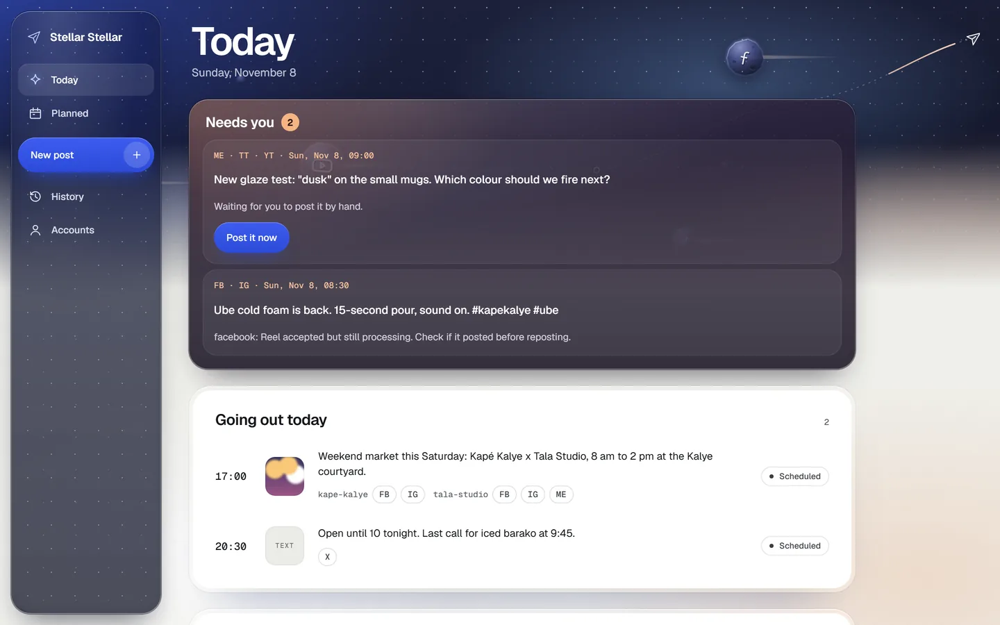
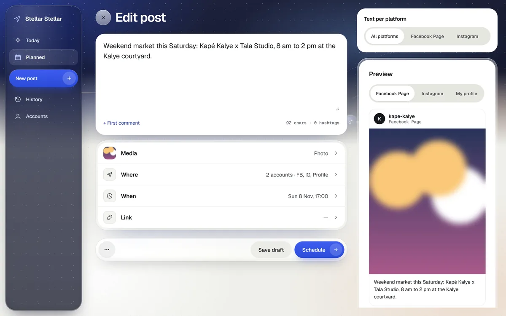
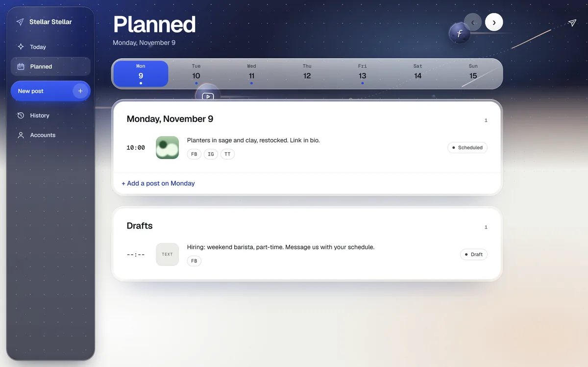
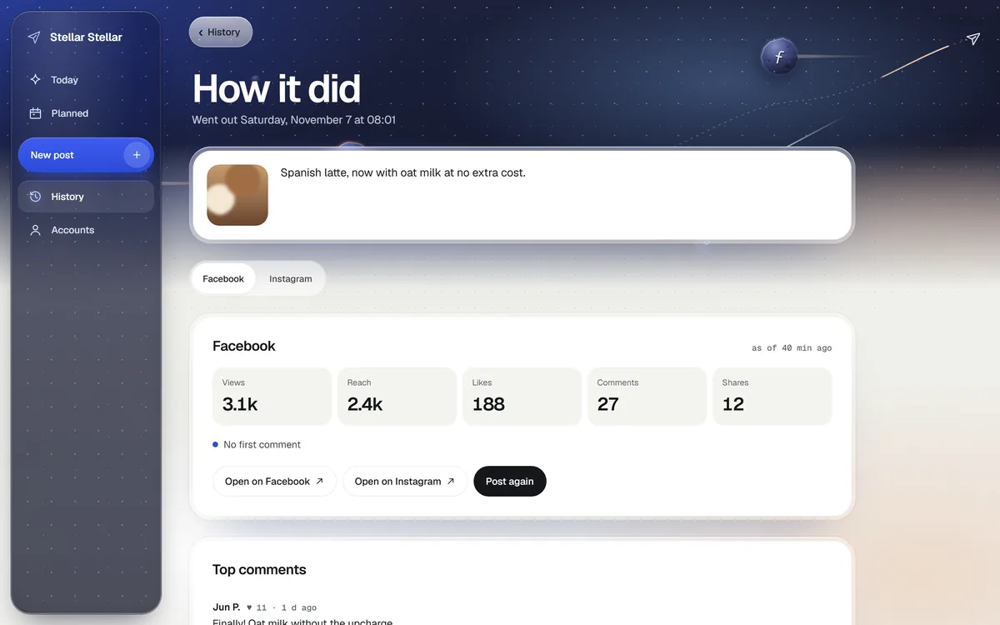
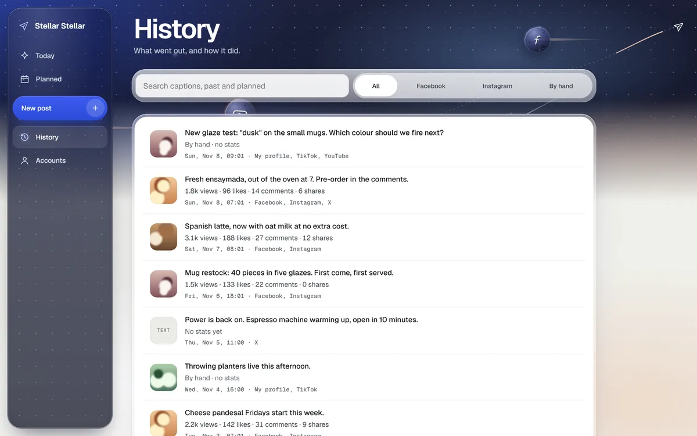
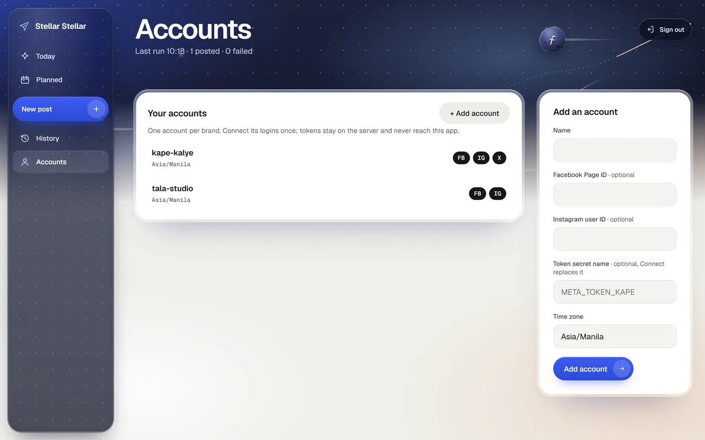

# Stellar Stellar (PostPilot)

[](https://github.com/bitwindamountains/PostPilot/actions/workflows/ci.yml)

Write a social post once and it goes out on schedule to Facebook Pages and Instagram, Reels included. Posts for platforms that don't let apps publish (a personal Facebook profile, YouTube, Shopee and TikTok) arrive on your phone through Telegram at post time, with the media and caption ready to share. The app is shown to users as **Stellar Stellar**; the code, repository and storage keys keep the name PostPilot.



> **Status:** live since October 2026. Real Facebook and Instagram posts go out on schedule. X posting is built and waits on its developer app. TikTok's review turned down a personal-use app, so TikTok stays by hand for now.

## Walkthrough

*Real UI with staged data: the brands are fictional and the Supabase API was mocked in the browser.*

**1. Write the post.** One caption with per-platform variations, the media, the accounts and the time, with a live preview for each platform.



**2. Plan the week.** A week strip of what is scheduled, and a drafts list for posts without a time yet.



**3. Finish it on the phone.** For platforms that block apps, the post arrives on the phone with the image and caption ready to share.


**4. See how it did.** Views, reach, likes, comments and shares per platform, plus the top comments.



**5. Look back.** Every post that went out, searchable and filterable by platform, including the ones posted by hand.



**6. Connect accounts.** One account per brand. Logins are connected once, and tokens never reach the browser.



## Engineering highlights

- **Never posts twice:** a run claims only posts that are still scheduled, and a filled platform ID marks that platform done for good. A Facebook Reel's ID is saved the moment Facebook accepts it, so a run killed mid-upload leaves the post marked "check if it posted" instead of retrying it.
- **On time:** GitHub's 30-minute schedule really runs every few hours, so a database timer (`pg_cron`, every 10 minutes) and **Post now** start the publisher as soon as a post is due. The GitHub token for that lives only in Supabase Vault.
- **Tokens stay server-side:** platform logins go through a Supabase Edge Function, tokens are stored in Vault, and the browser only ever holds the publishable key. Row-level security protects every table.
- **Safe to operate:** `doctor`, `validate` and `publish --dry-run` check the setup before anything is published.
- **Tested in CI:** 285 publisher tests and 98 web app tests.

## Tech stack

| Part | Technology |
| --- | --- |
| Publisher | Python, uv, GitHub Actions |
| App | React 19, Vite, TypeScript, installable PWA, hosted on Cloudflare |
| Backend | Supabase: PostgreSQL with row-level security, Auth, Realtime, Edge Functions, Vault, pg_cron |
| Platforms | Meta Graph API, X API, TikTok Content Posting API, Telegram Bot API |

## Quick start (publisher)
```bash
uv sync
cp .env.example .env          # fill in values
uv run --env-file .env postpilot doctor
uv run --env-file .env postpilot validate
uv run --env-file .env postpilot publish --dry-run
```

A filled platform ID on a post means that platform is done and is never posted again. If a post ends up
`failed` with "check if it posted", look at the platform first; only repost it if it is missing.
A real `publish` on your laptop needs `--local`; pause the GitHub schedule first, or two runs could both post it.

## Setup
1. **Supabase** (free): create a project, then run **every** file in `supabase/migrations/` in the SQL editor, oldest
   first (or `supabase db push` with the Supabase CLI). The app needs all of them.
   Under Authentication: turn **off** "Allow new users to sign up", then add yourself under Users.
2. **Web app**: in `web/`, copy `.env.example` to `.env` with the project URL and *publishable* key, then
   `npm install` and `npm run dev`. Deploy: Cloudflare Pages (or Workers static assets) with build command
   `npm run build`, output `dist`, root `web`, and the same two `VITE_` variables. Add the deployed URL to
   Supabase Authentication > URL Configuration (Site URL and Redirect URLs) so sign-in links work.
3. **Meta / X / TikTok**: connect them from the app's Accounts page (see [the connect-and-post design](docs/dev-notes/superpowers/specs/2026-10-28-connect-and-post-design.md)).
   A Page token in a GitHub secret named by the account's `token_env` (e.g. `META_TOKEN_MAIN`) also works for Meta.
4. **Telegram**: create a bot with @BotFather (gives `TELEGRAM_BOT_TOKEN`), send it a message, then read your chat
   id from `https://api.telegram.org/bot<token>/getUpdates`.
5. **GitHub**: use a **private** repo. Add secrets `SUPABASE_URL`, `SUPABASE_SERVICE_ROLE_KEY`, `TELEGRAM_BOT_TOKEN`,
   `TELEGRAM_CHAT_ID` (and any `META_TOKEN_*`, also listed in `.github/workflows/publish.yml`), and variables
   `META_GRAPH_VERSION` and `WEB_APP_URL`. The service-role key bypasses all access rules: keep it only in GitHub
   secrets, never in `web/`. Run the `publish` workflow manually (dry run is the default), then let it run on its own.
6. On your phone, open the app and use "Add to Home Screen".

### Posting on time
GitHub's 30-minute schedule really runs every few hours. A database timer (`dispatch_due`, every 10 minutes) and
"Post now" start the workflow as soon as a post is due. They need one fine-grained GitHub token (this repo only,
**Actions: read and write**) stored in Supabase Vault:
`select vault.create_secret('<token>', 'postpilot_github_token');`
Deploy `supabase/functions/dispatch` with JWT verification on; it needs no secrets of its own.

## Documentation

- [Development notes](docs/dev-notes/): the original blueprint, the task plan, design specs and plans, ideas and the progress log
